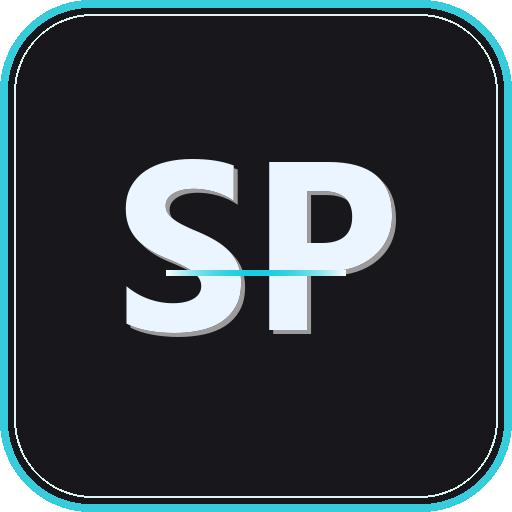

<p align="center">
  
</p>

<h1 align="center">ScreenPrompt</h1>

<p align="center">
  <b>Notes only you can see.</b><br>
  A transparent overlay for Windows that stays invisible in screen shares and recordings.
</p>

<p align="center">
  <a href="../../releases/latest"><b>Download for Windows</b></a>
  &nbsp;·&nbsp;
  <a href="../../discussions/51">Share your story</a>
  &nbsp;·&nbsp;
  <a href="../../issues/new?template=feature_request.md">Request a feature</a>
  &nbsp;·&nbsp;
  <a href="../../issues/new?template=bug_report.md">Report a bug</a>
</p>

<p align="center">
  
  
  <a href="https://tooomm.github.io/github-release-stats/?username=dan0dev&repository=ScreenPrompt"></a>
</p>


| You see | They see |
|:---:|:---:|
|  |  |

## Why

Keep talking points, names, numbers, and scripts right where you're looking, so you never have to glance at a second screen or your phone mid-call.

Hidden from Zoom, Teams, OBS, and Snipping Tool.

Made for calls, demos, streams, and presentations. It's not for cheating on exams or interviews,
or for getting around proctoring software or any platform's rules, and features for that won't be
added (see [Project scope](CONTRIBUTING.md#project-scope)).

## Features

- **Capture-proof**: excluded from screen shares and recordings
- **Always on top**: adjustable transparency and click-through lock
- **Keyboard-first**: every action has a shortcut
- **Formatted notes**: paste or write Markdown and see headings, **bold** and lists while you present
- **Auto-scroll**: your notes scroll by themselves at a speed you set, teleprompter style
- **Make it yours**: font, size, colors, and position presets
- **Private**: your notes never leave your PC; no telemetry, no data collection. The only network request is an update check against GitHub releases, which you can turn off in Settings

## Quick start

1. Download `ScreenPrompt_x.y.z_x64-setup.exe` from [Releases](../../releases/latest)
2. Install and launch
3. Type or paste your notes, then share your screen as usual

Requires Windows 10 (build 2004+) or Windows 11.

## Essential shortcuts

| Shortcut | Action |
|---|---|
| `Ctrl+Shift+H` | Show / hide |
| `Ctrl+Shift+L` | Lock (click-through) |
| `Esc` | Unlock (or Ctrl+click the lock icon) |
| `Ctrl+Shift+E` | Edit text |
| `Ctrl+Shift+Space` | Start / pause / resume auto-scroll |
| `F1` | All shortcuts (while ScreenPrompt is focused) |
| `Ctrl+Shift+F1` | Panic close, works even when locked |

## Locked mode

Lock the overlay (`Ctrl+Shift+L` or the lock icon) when you're presenting, and it gets out of your way:

- **Clicks and scrolling go through** to the app below, everywhere on the overlay, including the lock icon.
- **To scroll your notes**, hold `Ctrl` and scroll over the overlay.
- **To unlock**, press `Esc` or `Ctrl`+click the lock icon. The bottom bar shows this while locked.
- **To edit quickly**, press `Ctrl+Shift+E`: it unlocks until you click away, then locks again.

## Auto-scroll

Press `Ctrl+Shift+Space` (or the ▶ button) and your notes scroll by themselves. Press it again to
pause, and again to carry on. It works from any app, even while the overlay is locked.

- **Speed**: `Ctrl+Shift+,` slower, `Ctrl+Shift+.` faster while it's scrolling, or the − / +
  next to the ▶ button, or Settings. Speed is in lines per minute, so it's the same pace at any
  font size.
- **It stops** at the end of your notes; start it again to go back to the top.
- **Typing pauses it**, and scrolling with the wheel (or `Ctrl`+wheel while locked) just moves
  your place: it carries on from there.

## Formatting

ScreenPrompt formats your notes as you type, using Markdown: `# Heading`, `**bold**`, `*italic*`,
`~~strikethrough~~`, `- lists`, `1. numbered lists`, `- [ ] tasks`, `> quotes`, `` `code` `` and
`| tables |`. The
markers (`**`, `#`...) only show on the line you're typing on, so your notes always read cleanly;
while the overlay is locked they're hidden everywhere.

- **Bold / italic**: `Ctrl+B` / `Ctrl+I` while typing
- **Formatting toolbar**: the **T** button in the bottom bar opens buttons for every style
- **Links**: `Ctrl`+click opens a link in your browser
- **Tasks**: click a checkbox to tick it
- **Prompt tags** like `<context>` show as you typed them
- **Prefer plain text?** Turn off *Format text (Markdown)* in Settings

<details>
<summary><b>All shortcuts</b></summary>

These work anywhere, even while the overlay is locked or another app has focus:

| Shortcut | Action |
|---|---|
| `Ctrl+Shift+O` | Cycle opacity |
| `Ctrl+Shift+Q` | Quit |

These work while the overlay is focused (click it, or press `Ctrl+Shift+E` when locked), so they
don't override the same keys in your other apps:

| Shortcut | Action |
|---|---|
| `Ctrl+Shift+PageUp` / `PageDown` | Font size up / down |
| `Ctrl+Shift+Home` | Reset font size |
| `Ctrl+Shift+S` | Settings |
| `Ctrl+Shift+C` | Copy all text |
| `Ctrl+Shift+V` | Paste and replace all (undo with `Ctrl+Z` for a few seconds) |
| `Ctrl+Shift+Delete` | Clear all text (undo with `Ctrl+Z` for a few seconds) |
| `Ctrl+Shift+Arrows` | Nudge window 20px |
| `Ctrl+Shift+R` | Reset size and position |

**Position presets** work anywhere (layout is auto-detected, or set it in Settings)

| Position | QWERTY | QWERTZ |
|---|---|---|
| Top row | `Ctrl+Alt+7/8/9` | `Ctrl+Shift+7/8/9` |
| Middle row | `Ctrl+Alt+4/5/6` | `Ctrl+Shift+4/5/6` |
| Bottom row | `Ctrl+Alt+1/2/3` | `Ctrl+Shift+1/2/3` |

</details>

<details>
<summary><b>Build from source</b></summary>

Requires Node.js 20+ and [rustup](https://rustup.rs/), which installs the pinned Rust version
on the first build.

```bash
git clone https://github.com/dan0dev/ScreenPrompt.git
cd ScreenPrompt/screenprompt-tauri
npm install
npm run tauri build
```

The installer is written to `src-tauri/target/release/bundle/nsis/`.

</details>

## What ScreenPrompt does on your PC

ScreenPrompt uses a few Windows features that are worth knowing about. None of them records your
input or sends it anywhere.

- **Hidden from capture**: the overlay calls `SetWindowDisplayAffinity` with
  `WDA_EXCLUDEFROMCAPTURE`, so Windows leaves it out of screen shares, recordings, and
  screenshots.
- **Click-through lock**: locking marks the window as transparent to the mouse, so clicks and
  scrolling reach the app below.
- **Keyboard and mouse hooks, only while locked**: a locked window gets no input of its own, so
  ScreenPrompt installs two low-level hooks while it is locked and removes them when you unlock.
  The keyboard hook only reacts to `Esc` (to unlock) and passes every key through. The mouse hook
  only reacts to `Ctrl`+click on the lock icon and `Ctrl`+wheel over the overlay. Nothing is
  logged, stored, or sent anywhere.
- **Global shortcuts**: shortcuts that work anywhere, such as `Ctrl+Shift+H`, are registered with
  Windows. The rest only work while the overlay is focused.
- **Update check**: see [Privacy](#privacy).

## Privacy

Your notes and settings are stored only on your PC. ScreenPrompt has no telemetry, no analytics,
and no accounts.

This program will not transfer any information to other networked systems unless specifically
requested by the user or the person installing or operating it, with these exceptions:

- **Update check**: on startup, ScreenPrompt asks the GitHub Releases API
  (`api.github.com`) for the latest version number. The request contains no notes, settings, or
  personal data, but GitHub sees your IP address, as with any web request. If a newer version is
  available, ScreenPrompt asks you before downloading it from GitHub. To turn the check off, open
  Settings and clear **Check for updates on startup**. GitHub's handling of the request is covered
  by the [GitHub Privacy Statement](https://docs.github.com/site-policy/privacy-policies/github-general-privacy-statement).
- **WebView2 during installation**: if your PC doesn't have Microsoft Edge WebView2 (Windows 11
  and most Windows 10 PCs already do), the installer downloads it from Microsoft. This is covered
  by the [Microsoft Privacy Statement](https://privacy.microsoft.com/privacystatement).

## Share your story

How do you use ScreenPrompt? Tell us in [this discussion](../../discussions/51): what you use it
for, how it feels, and what's missing. Many of the stories will appear on the upcoming
ScreenPrompt website (only if you say it's OK).

## Code signing policy

Free code signing provided by [SignPath.io](https://about.signpath.io), certificate by
[SignPath Foundation](https://signpath.org).

- Committers and reviewers: [dan0dev](https://github.com/dan0dev)
- Approvers: [dan0dev](https://github.com/dan0dev)
- Privacy policy: see [Privacy](#privacy)

Signed releases are built by [GitHub Actions](.github/workflows/release.yml) from the source code
in this repository, and each one is approved by hand before it is signed.

---

[MIT License](LICENSE) · [Contributing](CONTRIBUTING.md)
